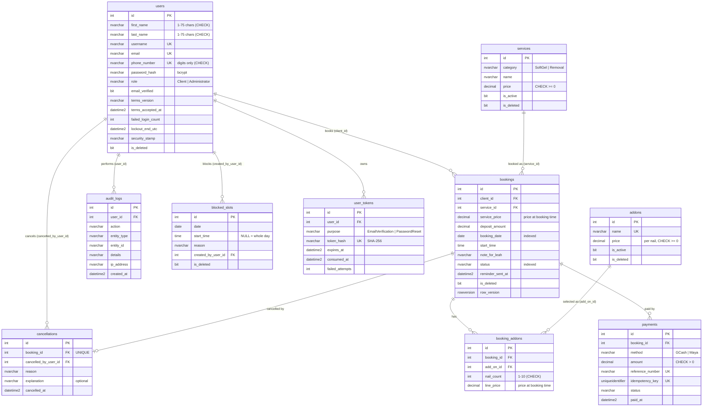

# Entity-Relationship Diagram (Ref 13.1)

The schema is created by the EF Core migration in `Data/Migrations`. Table and column names are snake_case.

`blocked_slots` (Ref 11.4) and `user_tokens` (Ref 1.4, 9.1) are added to the eight required tables.

## How the schema meets the requirements

| Ref | Requirement | Where |
|---|---|---|
| 13.2 | 3NF | Every non-key column depends only on its table's key. Totals and balances are computed, not stored. The canceller's role comes from `users`, not a copy. |
| 13.3 | Indexes | `ux_users_username`, `ux_users_email`, `ix_bookings_booking_date_start_time`, `ix_bookings_status` |
| 13.4 | ON DELETE RESTRICT | Every foreign key is `ON DELETE NO ACTION`, which is how SQL Server implements RESTRICT. A booking with payments cannot be deleted. |
| 13.5 | Soft delete | `is_deleted` on `users`, `services`, `addons`, `bookings`, `blocked_slots`. Nothing is deleted by the application. |
| 13.6 | Price at booking time | `bookings.service_price`, `bookings.deposit_amount`, `booking_addons.line_price` |
| 6.2 | Consistency | PK/FK, UNIQUE (username, email, phone), NOT NULL, CHECK (name length, digits-only phone, non-negative prices) |
| 6.3 | Isolation | `ux_bookings_active_slot` (one Pending/Confirmed booking per slot) and the `UPDLOCK, HOLDLOCK` slot lock in `BookingRepository.LockSlotAsync` |
| 13.7 | Backups | `backup-database.ps1`, `register-daily-backup.ps1`, `test-restore.ps1` |
